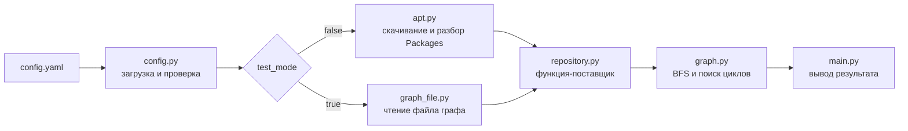

# Визуализатор графа зависимостей пакетов (Ubuntu apt)

Учебный CLI-инструмент на Python, который строит граф зависимостей пакета
Ubuntu, не используя менеджеры пакетов и сторонние библиотеки для получения
зависимостей. Данные берутся напрямую из индекса `Packages` репозитория.

> **Текущий этап: 3 из 5** (ветка `stage3`): транзитивный граф, обход BFS,
> обработка циклов, тестовый режим.

## Содержание

1. [Общее описание](#1-общее-описание)
2. [Описание функций и настроек](#2-описание-функций-и-настроек)
3. [Сборка и запуск тестов](#3-сборка-и-запуск-тестов)
4. [Примеры использования](#4-примеры-использования)

---

## 1. Общее описание

### Назначение

По имени пакета программа определяет, от каких пакетов он зависит прямо и
косвенно (транзитивно), и выводит получившийся граф. Если в зависимостях
есть циклы, они находятся и выводятся отдельно.

### Возможности этапа 3

| Возможность | Реализация |
|---|---|
| Источник настроек | YAML-файл конфигурации |
| Формат пакетов | Ubuntu (apt), индекс `Packages`, `.gz`, `.xz` или обычный текст |
| Прямые зависимости | Поля `Pre-Depends` и `Depends` |
| Транзитивные зависимости | Обход в ширину (BFS), **без рекурсии** |
| Циклические зависимости | Не вызывают зацикливания, выводятся списком |
| Тестовый режим | Файл описания графа с пакетами `A`, `B`, `C`, ... |
| Ошибки | Все параметры и данные проверяются, ошибка выводится в `stderr` |

### Ограничения

- Из альтернативных зависимостей вида `a | b` берётся первая (`a`).
- Версии, архитектуры и условия сборки в зависимостях (`(>= 1.0)`, `:any`,
  `[amd64]`, `<!nocheck>`) отбрасываются.
- Пакеты, которых нет в загруженном индексе (виртуальные или из других
  разделов), считаются пакетами без зависимостей.
- Параметр `output_file` на этом этапе только проверяется; изображение
  графа будет создаваться на следующих этапах.

### Схема работы



Алгоритм построения графа не зависит от источника данных: ему передаётся
функция `provider(имя)`, которая возвращает список прямых зависимостей или
`None`, если пакет неизвестен.

### Структура репозитория

```
.
├── README.md
├── .gitignore
├── Makefile
├── requirements.txt
├── config.yaml
├── src/
│   ├── main.py          точка входа, вывод результата
│   ├── config.py        загрузка и проверка конфигурации
│   ├── apt.py           получение и разбор индекса Packages
│   ├── graph.py         BFS и поиск циклов
│   ├── graph_file.py    чтение тестового файла графа
│   └── repository.py    выбор источника данных
└── tests/
    ├── test_config.py
    ├── test_apt.py
    ├── test_graph.py
    ├── test_graph_file.py
    └── data/            тестовые репозитории
```

---

## 2. Описание функций и настроек

### 2.1. Настройки (`config.yaml`)

| Параметр | Тип | Описание |
|---|---|---|
| `package_name` | строка | Имя анализируемого пакета. В обычном режиме: строчные латинские буквы, цифры и символы `+ . -`, минимум 2 символа. В тестовом режиме: только заглавные латинские буквы |
| `repository_url` | строка | При `test_mode: false`: URL индекса `Packages` (`http://` или `https://`). При `test_mode: true`: путь к файлу описания графа |
| `test_mode` | `true` / `false` | Режим работы с тестовым репозиторием |
| `output_file` | строка | Имя файла для изображения графа, расширение `.png`, `.svg` или `.jpg`; папка должна существовать |

Пример:

```yaml
package_name: curl
repository_url: http://archive.ubuntu.com/ubuntu/dists/jammy/main/binary-amd64/Packages.gz
test_mode: false
output_file: graph.png
```

### 2.2. Формат файла тестового репозитория

Одна строка на пакет. Имена пакетов состоят из заглавных латинских букв.

```
A: B C      пакет A зависит от B и C
D:          у пакета D нет зависимостей
```

Правила: пустые строки пропускаются, повторное описание пакета считается
ошибкой, пакет, упомянутый только в зависимостях, считается пакетом без
зависимостей.

### 2.3. Ошибки

Программа завершается с кодом `1` и пишет сообщение в `stderr`.

| Ситуация | Сообщение |
|---|---|
| Нет файла конфигурации | `файл конфигурации не найден: ...` |
| Некорректный YAML | `некорректный YAML: ...` |
| Конфигурация не словарь | `конфигурация должна быть словарём ключ: значение` |
| Нет параметра | `отсутствует параметр: ...` |
| Неверное имя пакета | `некорректное имя пакета: ...` |
| `test_mode` не `true`/`false` | `test_mode должен быть true или false` |
| Неверный URL | `URL должен начинаться с http:// или https://` |
| Нет тестового файла | `тестовый файл не найден: ...` |
| Неверное расширение картинки | `расширение должно быть одним из ...` |
| Нет папки для картинки | `папка не существует: ...` |
| Репозиторий недоступен | `не удалось прочитать репозиторий: ...` |
| Пакет не найден | `пакет не найден в репозитории: ...` |
| Неверная строка файла графа | `строка N: некорректный формат: ...` |
| Повтор пакета в файле графа | `строка N: повторное описание ...` |

### 2.4. Описание функций

#### `src/main.py`

| Функция | Назначение |
|---|---|
| `parse_args()` | Разбирает аргумент командной строки (путь к конфигурации) |
| `print_graph(name, graph)` | Печатает граф: для каждого пакета список его зависимостей |
| `print_cycles(cycles)` | Печатает найденные циклы или сообщение об их отсутствии |
| `main()` | Загружает конфигурацию, строит граф, печатает результат, возвращает код выхода |

#### `src/config.py`

| Функция | Назначение |
|---|---|
| `load_config(path)` | Читает YAML-файл, возвращает словарь |
| `validate_config(config)` | Проверяет наличие всех параметров и вызывает проверки ниже |
| `check_test_mode(config)` | Проверяет, что `test_mode` логическое значение |
| `check_package_name(config)` | Проверяет имя пакета с учётом режима |
| `check_repository(config)` | Проверяет URL или существование тестового файла |
| `check_output_file(config)` | Проверяет расширение и папку файла изображения |

Исключение: `ConfigError`.

#### `src/apt.py`

| Функция | Назначение |
|---|---|
| `read_bytes(location, test_mode)` | Читает данные из файла или по URL |
| `decompress(data, location)` | Распаковывает `.gz` и `.xz` по расширению |
| `read_index(location, test_mode)` | Возвращает текст индекса пакетов |
| `parse_block(block)` | Разбирает описание одного пакета в словарь полей |
| `parse_packages(text)` | Разбирает весь индекс: имя пакета и его поля |
| `clean_name(text)` | Убирает из зависимости версию, архитектуру и условия |
| `parse_depends(value)` | Превращает строку `Depends` в список имён |
| `get_dependencies(name, packages)` | Возвращает прямые зависимости пакета без повторов |
| `make_apt_provider(packages)` | Создаёт функцию-поставщик для построения графа |

Исключение: `AptError`.

#### `src/graph.py`

| Функция | Назначение |
|---|---|
| `build_graph(start, provider)` | Строит граф обходом в ширину, возвращает словарь «пакет: список зависимостей» |
| `find_cycle(graph, node)` | Находит кратчайший цикл через заданный пакет |
| `restore_path(parents, last, node)` | Восстанавливает путь цикла по таблице предков |
| `find_cycles(graph)` | Возвращает список различных циклов графа |

Исключение: `GraphError`.

#### `src/graph_file.py`

| Функция | Назначение |
|---|---|
| `parse_graph_text(text)` | Разбирает текст описания графа |
| `read_graph_file(path)` | Читает файл описания графа |

#### `src/repository.py`

| Функция | Назначение |
|---|---|
| `make_provider(config)` | Выбирает источник данных по `test_mode` и возвращает функцию-поставщик |

### 2.5. Алгоритмы

**Построение графа (BFS).** Очередь `deque` хранит пакеты, которые ещё нужно
обработать, множество `visited` хранит уже добавленные в очередь. Пакет
извлекается из очереди, его зависимости запрашиваются у поставщика, ещё не
встречавшиеся зависимости добавляются в очередь. Рекурсия не используется.
Сложность: `O(V + E)`.

**Циклы.** Так как каждый пакет попадает в очередь один раз, цикл не может
привести к бесконечному обходу. Для вывода циклов для каждого пакета
выполняется BFS по его зависимостям до возвращения в него (кратчайший цикл).
Зависимость пакета от самого себя также считается циклом. Циклы с одинаковым
набором пакетов выводятся один раз. Сложность: `O(V · (V + E))`.

---

## 3. Сборка и запуск тестов

Сборка не требуется (Python-проект). Нужны Python 3.9+ и библиотека PyYAML,
которая используется только для чтения конфигурации.

```bash
git clone <адрес репозитория>
cd <папка репозитория>
git checkout stage3

python -m pip install -r requirements.txt
```

Запуск программы:

```bash
make run
# или без make
python src/main.py config.yaml
```

Запуск тестов:

```bash
make test
# или без make
python -m unittest discover -s tests
```

| Файл тестов | Что проверяет |
|---|---|
| `tests/test_config.py` | Проверку каждого параметра конфигурации |
| `tests/test_apt.py` | Разбор индекса `Packages` и извлечение зависимостей |
| `tests/test_graph.py` | Порядок BFS, циклы, самозависимость, неописанные пакеты |
| `tests/test_graph_file.py` | Формат файла тестового графа и ошибки чтения |

---

## 4. Примеры использования

Во всех примерах запуск выглядит одинаково:

```bash
python src/main.py config.yaml
```

### 4.1. Реальный репозиторий Ubuntu

```yaml
package_name: curl
repository_url: http://archive.ubuntu.com/ubuntu/dists/jammy/main/binary-amd64/Packages.gz
test_mode: false
output_file: graph.png
```

Программа скачает индекс, построит транзитивный граф пакета и выведет его в
формате `пакет: зависимости`, затем список найденных циклов. Результат зависит
от текущего состояния репозитория.

### 4.2. Тестовый режим: граф без циклов («ромб»)

Файл `tests/data/diamond.txt`:

```
A: B C
B: D
C: D
D:
```

Конфигурация:

```yaml
package_name: A
repository_url: tests/data/diamond.txt
test_mode: true
output_file: graph.png
```

Вывод (общая зависимость `D` не дублируется):

```
Граф зависимостей пакета A (обход BFS):
  A: B C
  B: D
  C: D
  D: (нет зависимостей)
Всего пакетов в графе: 4
Циклические зависимости не найдены.
```

### 4.3. Простой цикл

Файл `tests/data/cycle.txt`:

```
A: B
B: C
C: A
```

Вывод при `package_name: A`:

```
Граф зависимостей пакета A (обход BFS):
  A: B
  B: C
  C: A
Всего пакетов в графе: 3
Найдены циклические зависимости:
  A -> B -> C -> A
```

### 4.4. Несколько циклов и самозависимость

Файл `tests/data/many_cycles.txt`:

```
A: B C
B: A D
C: C
D: E
E: D
```

Вывод при `package_name: A`:

```
Граф зависимостей пакета A (обход BFS):
  A: B C
  B: A D
  C: C
  D: E
  E: D
Всего пакетов в графе: 5
Найдены циклические зависимости:
  A -> B -> A
  C -> C
  D -> E -> D
```

### 4.5. Недостижимые и неописанные пакеты

Файл `tests/data/undefined.txt`:

```
A: B
X: Y
```

Вывод при `package_name: A`:

```
Граф зависимостей пакета A (обход BFS):
  A: B
  B: (нет зависимостей)
Всего пакетов в графе: 2
Циклические зависимости не найдены.
```

Пакет `B` нигде не описан, поэтому считается пакетом без зависимостей. Пакеты
`X` и `Y` недостижимы из `A` и в граф не попадают.

### 4.6. Обработка ошибок

| Изменение в конфигурации | Вывод в `stderr` |
|---|---|
| `package_name: Z` (в `diamond.txt` нет такого пакета) | `Ошибка: пакет не найден в репозитории: Z` |
| `repository_url: tests/data/broken.txt` | `Ошибка: строка 1: некорректный формат: 'A B C'` |
| `package_name: a` при `test_mode: true` | `Ошибка: некорректное имя пакета: 'a'` |
| `repository_url: tests/data/nope.txt` при `test_mode: true` | `Ошибка: тестовый файл не найден: tests/data/nope.txt` |
| `test_mode: maybe` | `Ошибка: test_mode должен быть true или false` |
| `output_file: graph.txt` | `Ошибка: расширение должно быть одним из ('.png', '.svg', '.jpg')` |

Код возврата при любой ошибке равен `1`.

---

## Этапы разработки

| Ветка | Содержание |
|---|---|
| `stage1` | CLI, YAML-конфигурация, проверка параметров |
| `stage2` | Получение прямых зависимостей из индекса Ubuntu |
| `stage3` | Транзитивный граф (BFS), циклы, тестовый режим |
| `stage4` | В разработке |
| `stage5` | В разработке |
